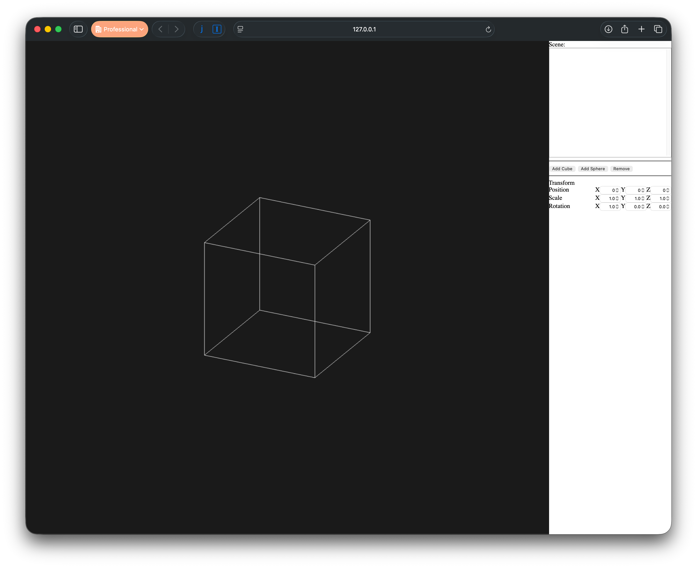

# Practical Lesson 5 - Instantiation of Primitives

## Introduction

In this session, we will develop a small application that allows you to view a scene defined by the instantiation of primitive objects, to which a specific instantiation transformation will be associated.

The user can add to the scene, whose structure is linear (a simple list of objects), an object chosen from a set of available primitive objects.

The skeleton of the application is provided and can be obtained from the [repository](https://gitlab.com/CGI-Code/cgi-25-26) that we have been using.

If you notice, when the application is launched, we only see a cube, which does not change because the application interface is not currently doing anything useful.

Read the application code [app.js](../../src/labs/ex17-step0/app.js) and identify where the object is drawn. You will notice that the function used to draw the primitive object is part of one of the JavaScript modules provided with the example. Take a look at the files [libs/objects/cube.js](../../src/libs/objects/cube.js) and [libs/objects/sphere.js](../../src/libs/objects/sphere.js). Note the functions that are exported by the modules, what they do, and where they are being called in the [app.js](../../src/labs/ex17-step0/app.js) script.

The right side of the interface is organized as follows:

- Top: a list containing the name of each of the objects that make up the scene displayed on the left side of the window
- A section with buttons where you can add new primitive objects or delete an object from the scene
- A "Solid" checkbox, which switches between drawing the objects as wireframes and drawing them filled
- A section showing the properties of the selected (active) object

In solid mode, since there is no lighting yet, each fragment is coloured by its normal vector, mapped from [-1, 1] to [0, 1], so that the faces of an object can be told apart. For filled objects to hide what lies behind them, the application already enables the depth buffer (Z-buffer): `gl.enable(gl.DEPTH_TEST)` in `setup()`, and `gl.DEPTH_BUFFER_BIT` in the `gl.clear()` of each frame. It keeps, for each pixel, only the fragment nearest to the camera. Visibility will be studied in detail later; for now, just keep these two lines in every exercise.

## ex17 - Adding objects to the scene

Modify the given application so that we can add a cube or a sphere to the list of objects in the scene by pressing the appropriate button. The name of the object to be added to the list can be generated automatically, but it should be unique for each instance. Refer to the documentation for HTMLSelectElement objects, paying particular attention to the add() method.

To do this, you will need to make the following changes:

- Program the event handlers for the “Add Cube” and “Add Sphere” buttons. For each of these buttons, you must record in your application (using one or more arrays) that you have another instance of a primitive object. For now, it will suffice to record which of the primitives was created, but later this will have to be changed.
- Modify the function that redraws the canvas to go through the information stored in the instance vector and draw the corresponding object. Note that to draw an object, the vertex shader provided expects to be given a 4x4 matrix (u_ctm) representing the current transformation matrix for that instance. This matrix corresponds to the product of three matrices:

    `mProjection * mView * mModel`. 

    The first two matrices are already initialized and do not need to be changed. The last matrix corresponds to the modeling transformation of the instance being drawn. To begin with, you can assume that it is the identity matrix. In the next exercise, this will be modified.

## ex18 - Editing the transformation of the last object inserted

In exercise ex17, we reached a point where we can add cubes and spheres to our scene, but we can only distinguish a maximum of two objects—a cube and a sphere—even if we have created several of each type.

What is happening is that the various cubes that may have been created cannot be distinguished from each other, and the same is true for the various spheres that may have been created.

To solve this problem, we will associate each instance with a geometric instantiation transformation that will allow us to scale, orient, and position the objects in the scene and thus distinguish the various instances.

For now, we will only make the interface available to affect the last instance created. Thus, if the scene is empty, the respective interface elements should be inactive. When an instance is added, any change in these interface elements should produce a change in the specific mModel transformation of that instance, so that when the scene is drawn, we can see the object with the respective transformation applied.

The mModel matrix of the instance being manipulated corresponds to the following composition:

    mModel = T(px, py, pz) Rz(rz) Ry(ry) Rx(rx) S(sx, sy, sz)

The values of the parameters of these transformations are those present in the interface.

To solve this exercise, you must:

- Program the “change” events of the interface elements and update the mModel matrix of the last instance.
- Add the respective mModel transformation to the instance vector.

## ex19 - Removing instances

Program the “Remove” button event to remove the instance selected in the list. When you delete that instance, the previous one should become selected.

## ex20 - Editing the transformation of any object in the scene

Modify the application so that you can select any instance from the list and then edit the modeling transformation of that instance.

To perform this task, you first need to retrieve the parameters and place them in the interface boxes. This is impossible if you have only saved the mModel matrix for each instance. Think of a solution and implement it.

## ex21 - Order of application of transformations
Try changing the order of application of the transformations, testing the following (in this order of application):

- 1st Rotations, 2nd Scale, 3rd Translation
- 1st Rotation, 2nd Translation, 3rd Scale
- 1st Translation, 2nd Scale, 3rd Rotations
- 1st Translation, 2nd Rotations, 3rd Scale

## ex22 - Additional primitives

Add the following primitives to your application:

- cylinder
- torus
- pyramid

Don't forget to add the corresponding buttons.

## Challenges for autonomous study

The problems below are optional and are not solved during the session. They
build on ex20, the version where any instance can be selected and edited, and
stay with a linear scene: no instance is placed relative to another one yet.

Work on a copy, as usual. Create one folder per problem, named `my-prob13`,
`my-prob14` and so on. The numbering continues from the problems of Session 03.

### prob13 - Colour, highlighting and duplicates

Give every instance its own colour, chosen with an
[`<input type="color">`](https://developer.mozilla.org/en-US/docs/Web/HTML/Element/input/color)
in the properties section and passed to the fragment shader as a
`uniform vec4 u_color`. Draw the selected instance at full brightness and all
the others dimmed, so it is always clear which one the interface is editing.

Then add a "Duplicate" button that creates a new instance of the same
primitive, with the same colour and transformation parameters as the selected
one but pushed slightly along x, and selects it. Edit the copy and check that
the original does not move with it.

**Help:** the colour input's value is a string `"#rrggbb"`;
`parseInt(hex.slice(1, 3), 16) / 255` gives the red component in [0, 1]. If
editing the copy also changes the original, look at what the copy's parameter
array actually is.

### prob14 - Local axes

Draw the axes of the selected instance's own frame: three unit segments from
its origin along its local x, y and z, in red, green and blue, drawn with the
instance's transformation. Draw the world axes at the origin too, in dimmer
colours, for comparison.

Then let the keys `a`/`d`, `w`/`s` and `q`/`e` move the selected instance a
small step along x, y and z, and a further key toggle between moving along the
world axes and along the instance's own. In both cases the result has to end up
in the position boxes of the interface.

**Help:** the instance's local axes, written in world coordinates, are the
images of (1,0,0), (0,1,0) and (0,0,1) under its rotation - that is, the columns
of the rotation matrix. Ignore key presses whose target is an `<input>`, or
typing in a number box will move the object; and remember that a focused
`<select>` jumps to the option starting with the letter pressed.

### prob15 - Rotating with the keyboard

Let six keys rotate the selected instance by a few degrees at a time about x, y
and z, and a further key choose whether those are the world's axes or the
instance's own (draw its local axes as in `prob14`, to see the difference). In
both cases the object turns about its own centre, not about the world origin.

The rotation boxes of the interface must keep showing the current orientation.
Since the instance is described by the angles `rx`, `ry`, `rz` of
`Rz(rz) Ry(ry) Rx(rx)`, after each key press you have to find the angles that
produce the new rotation matrix.

1. Multiply out `Rz Ry Rx` and find which entries of the result give `ry`, and
   which give `rx` and `rz` once `ry` is known. Implement that decomposition.
2. Implement the key presses as a small rotation composed with the instance's
   current rotation, followed by the decomposition. On which side does the small
   rotation go for world axes, and on which for local axes? Why?
3. In the interface, set `ry` to 90 and change `rx` and `rz`. What happens? What
   does your decomposition do there, and why can it not do better?

**Help:** use [Math.atan2()](https://developer.mozilla.org/en-US/docs/Web/JavaScript/Reference/Global_Objects/Math/atan2),
not `Math.atan()`, so that every quadrant comes out right. Keeping the angles as
the only state, and rebuilding the matrix from them each time, also avoids the
slow drift that repeated matrix products accumulate.

### prob16 - Rings and helices

Add a "Make ring" button that fills a circle around the world y axis with `n`
copies of the selected instance: copy `k` is the original rotated by
`k * 360 / n` degrees about that axis, so the copies are not only placed around
the circle but also turned to face along it, the way a cube on a turntable
would be.

Each copy must be an ordinary instance, editable through the interface like any
other, which means its transformation has to be expressed by the nine parameters
again. Work out what its position, rotation and scale parameters are.

Then extend it with two more values: a rise per copy, lifting copy `k` by `k`
times that amount, to turn the ring into a helix, and a scale factor per copy,
scaling copy `k` by that factor to the power `k` about the origin, to turn it
into a spiral.

Finally, think about two variations without necessarily implementing them: what
do you get if the rotation is composed on the other side of the instance's
transformation? And how would you centre the ring on some point other than the
origin?

**Help:** for any linear transformation `A` (a rotation or a scale),
`A T(p) = T(A p) A`. The rotation part of a copy is a product of two rotation
matrices, which `prob15` already knows how to turn back into angles.
